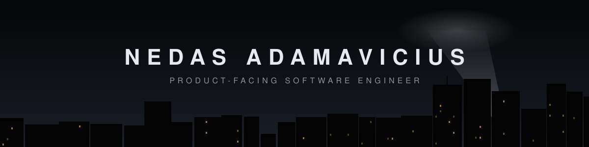

What drives me is bridging people and software: understanding what people actually need, and building software that helps them, using AI to get there efficiently.

I care about actually shipping things, owning what I build, and not overcomplicating stuff.

**Fun fact:** you'll never meet anyone as committed to building what truly matters. I have the history to
back it up; most who claim it don't.

### What I've built

#### [Dynamic Program](https://dynamicprogram.app/)

My own product. I discovered the need for it, then took it from early prototypes to a shipped, evolving
product, live on the App Store and Google Play.

#### ASML

- A dashboard and ETL pipeline that replaced a manual workflow, saving up to 50% of the time.
- A DSL code generator that uses an internal API to generate DSL code, which in turn generates C++ code for ASML machines.

#### Fontys

SWE & PM on a generative AI project tackling bias in dermatology datasets, awarded for real-world impact. 

Was responsible for, and helped ship, reproducible pipelines with Nix and Docker that run the same on macOS, Linux and Windows.

#### FSFE

Owned an improvement end to end: cut slow graph database queries from ~80s to ~30s, and made it usable in the
UI through a search filter, live on [TEDective](https://tedective.org). Also raised test coverage to 80%.

Find me on [LinkedIn](https://www.linkedin.com/in/nedasadamavicius/)

<!--
**nedasadamavicius/nedasadamavicius** is a ✨ _special_ ✨ repository because its `README.md` (this file) appears on your GitHub profile.

Here are some ideas to get you started:

- 🔭 I’m currently working on ...
- 🌱 I’m currently learning ...
- 👯 I’m looking to collaborate on ...
- 🤔 I’m looking for help with ...
- 💬 Ask me about ...
- 📫 How to reach me: ...
- 😄 Pronouns: ...
- ⚡ Fun fact: ...
-->
